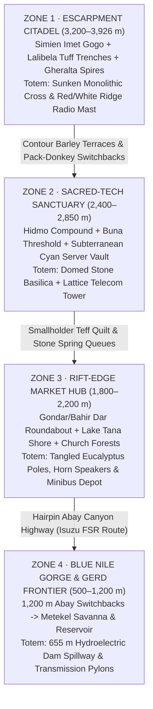

# ABYSSINIAN HIGHLANDS · Master World Bible, GTA Transect Architecture & Executable Worldtext Specification

> **Scope**: Authoritative geographic, remote-sensing, 3D reconstruction, ethnographic, and semiotic architecture for **Abyssinian Highlands** — an interactive open-world simulation spanning the *Roof of Africa* (`6°N–15°N, 35°E–42°E`), from the `3,926 m` basalt precipices of **Imet Gogo** and rock-hewn **Lalibela** down through the **Blue Nile (Abay) Gorge** to the `655 m` **Grand Ethiopian Renaissance Dam (GERD)** frontier.

---

## 1. Macro-Geography, Geology & Exact Earth Coordinates

The **Ethiopian (Abyssinian) Highlands** form the largest continuous high-altitude landmass in Africa (`>1,500 m / 4,900 ft`), uplifted ~75 Ma over ancient shield rock, capped by massive ~30 Ma flood-basalt traps, and split diagonally by the **Great East African Rift** into the northwestern **Abyssinian Massif** and southeastern **Harar Massif**.
- **Summits, Waters & Climate**: Crowns at **Ras Dashen** (`~4,550 m / 14,930 ft`, Simien Mountains); **Lake Tana** feeds the spiraling **Blue Nile (Abay)**. High elevation yields temperate *Weyna Dega* / *Dega* (`15–20°C` in Lalibela and Gondar) to cold afro-alpine *Wurch* (`<10°C`) plateaus, driven by the June–mid-September *Kiremt* Indian Ocean monsoon.
- **Endemic Afromontane Biodiversity**: **Ethiopian Wolf** (afro-alpine rodent hunter), **Gelada** (*Theropithecus gelada*, cliff-edge grazing troops), **Walia Ibex**, **Mountain Nyala**, and **Giant Lobelia** rosettes.

### Closest Topographic Parallels to Yosemite Valley & GERD Coordinates

| Landmark / Zone | Coordinates | Elevation & Relief | Structural & Visual Role |
| :--- | :--- | :--- | :--- |
| **Simien Mountains · Imet Gogo** *(Amhara)* | `13.2167° N, 38.0833° E` | `3,926 m` headland; `1,000–2,000 m` sheer northern drop | **Glacier Point parallel**: fractured volcanic tabletops & basalt spires plunging straight into the Geech Abyss. |
| **Gheralta Massif** *(Hawzen, E. Tigray)* | `13.9722° N, 39.4286° E` | `250 m+` freestanding vertical towers over flat plain | **El Capitan / Cathedral Spires parallel**: sheer red-and-gold Adigrat sandstone monoliths housing cliff-hewn churches (*Abuna Yemata Guh*). |
| **Blue Nile (Abay) Gorge** | `10.0750° N, 38.1917° E` | `400 km` canyon; `1,000–1,200 m` vertical relief | **"Grand Canyon of the Nile"**: plateau flood basalts stepping down through Mesozoic sandstone and limestone to the riverbed. |
| **Grand Ethiopian Renaissance Dam (GERD)** *(Metekel, Benishangul-Gumuz)* | `11.2153° N, 35.0931° E` | `500 m` riverbed; `655 m` crest; `1,350 m` ridges `<5 km` N | **Hydroelectric Lowland Frontier (*Kolla*)**: branching `74 billion m³` canyon reservoir (non-irrigation); fed by western escarpment **Mt. Belaya** (`2,731 m`) & **Mt. Dangur** (`2,488 m`). |
| **Lake Tana Agricultural Basin** | BBox `[37.0, 11.4, 37.8, 12.3]` | `~1,788 m` heart-shaped highland basin | Smallholder *teff* mosaics, radial flood-recession strips, and circular Orthodox church forests. |
| **Metekel / GERD Escarpment BBox** | BBox `[35.0, 10.9, 36.2, 11.8]` | `500 m – 2,731 m` abrupt plateau-to-savanna drop | Transition from highland smallholder quilts to mechanized rectangular *sesame*/*sorghum*/*maize* blocks. |

---

## 2. How the Map Works in GTA: The Compressed Socio-Spatial Transect

Rockstar open worlds (*GTA V*'s Los Santos/Blaine County, *GTA VI*'s Leonida) never use 1:1 GIS highway mileage, which produces dead traversal time. Instead, **Abyssinian Highlands** compresses `~500 km` of real Ethiopian watershed into a **4-Biome Elevation Transect** (`3–5 minutes` of driving, riding, or gliding end-to-end) governed by four spatial rules:

1. **Delete the Empty Middle**: Compress repetitive plateau miles while preserving exact *transition thresholds* (cliff-lip switchbacks, canyon bridges, town roundabouts).
2. **Sightline Choreography via Vertical Totems**: Players orient by cultural landmarks rather than UI minimaps—every ridge frames the next zone's vertical totem, while curved mountain switchbacks occlude distant chunks until the dramatic reveal.
3. **Ring Highway + Dendritic Trail Loop**: A primary paved escarpment trunk road (carrying Isuzu FSR trucks, blue-and-white HiAce line taxis, and sky-blue Bajaj rickshaws) loops around an interior network of dry-stone pack-donkey switchbacks and river-ford shortcuts.
4. **Altitude-Locked Agro-Ecology & Weather**: Fog density, crop shaders, livestock, architecture, and radio reception shift continuously with world `Y` elevation.



---

## 3. Orbital Agriculture: The 4 Field Geometries & Sub-Meter Parcel Stack

From orbit, Ethiopian agriculture never forms US-style square townships or center-pivot circles. Terrain slope, *maresha* ox-plow turning radii, inheritance subdivision, and monsoon runoff carve **four distinct parcel geometries** that drive our terrain splatmaps and Geometry Nodes / procedural field masks:

1. **Irregular Polygons & Trapezoids *(Flat/Gently Sloping Plateaus, `1,700–2,600 m`)* (`Weyna Dega`)**
   - *Geometry*: Tight organic jigsaw of `0.1–0.5 ha` skewed rectangles and trapezoids bounded by stone bunds, footpaths, and circular dark-green **Ethiopian Orthodox Church Forests**.
   - *Crops*: **Teff** (sown July *Kiremt* rains, harvested Nov–Dec; greens → golds → dark volcanic vertisol), wheat, pulses, Arabica coffee & *khat* in warmer valleys.
2. **Curved Ribbon Strips & Contour Bands *(Steep Basalt Ridges, `2,400–3,700 m`)* (`Dega`)**
   - *Geometry*: Concentric, fingerprint-like S-curves and crescents following elevation contours via *fanya juu* and bench stone-bund terracing.
   - *Crops*: Frost-hardy **barley**, fava beans, potatoes, and communal sheep/goat/donkey/cattle grazing buffers.
3. **Long, Narrow Perpendicular Strips *(Lake Tana & Gilgel Abay Margins)***
   - *Geometry*: Skinny radial wedges (`8–20 m` wide) oriented perpendicular to riverbanks/shorelines so dozens of households share equitable flood-recession moisture.
4. **Large Sharp-Edged Rectangular Blocks *(Metekel / GERD Lowlands, `500–1,500 m`)* (`Kolla`)**
   - *Geometry*: Mechanized commercial clearings cut into woodland savanna alongside patchy traditional Gumuz hoe-cultivated plots (strictly rain-fed: **sorghum**, **maize**, **sesame**, **noug/niger seed**, soybeans, groundnuts, cotton).

### Granular Geospatial & Sub-Meter Parcel Datasets

| Dataset | Resolution & Scale | Access / Endpoint | Pipeline Role |
| :--- | :--- | :--- | :--- |
| **Fields of the World (`FTW`)** | `10 m` Sentinel-2 PRUE vector instances (`2024–2025` full Ethiopia) | `GeoParquet` / `GeoJSON`: `s3://us-west-2.opendata.source.coop/tge-labs/ftw-global-data/` | Instant vector polygons of smallholder parcels over Simien, Tana & Abay rims. |
| **Second-Level Land Certification (`SLLC`)** | `0.25 m` aerial orthophotos (`1:2,000–1:5,000`, `50M+` parcels) | MoA / LIFT rural cadastral layers (Amhara, Tigray, Oromia, SNNPR) | Legal parcel topology, stone boundary bunds, footpaths & communal grazing commons. |
| **Ethiopian Crop Type 2020 (`EthCT2020`)** | `2,793` ground-truthed `10 m` plots across `22` crop classes + `3 m` PlanetScope | Shapefile (`DOI: 10.17632/mfpvmk8cnm.1`) & IIASA STAC `GeoParquet` | Assigning calibrated spectral/seasonal crop states (teff, barley, sorghum, pulses). |
| **DE Africa 10m Cropland Extent** | `10 m` (`0.01 ha`) Random Forest binary mask & probability | STAC: `https://explorer.digitalearth.africa/stac` (`crop_mask_eastern`) | Separating active cultivation from afro-alpine moorland, savanna & gorge rock. |
| **Commercial Farms in Lowlands & WB `50x2030`** | `190+` mechanized farms (`<1,500 m`) + `10 m` maize GeoTIFFs | World Bank Data Catalog (`0037937`) & EthioSIS (`https://data.moa.gov.et/dataset/`) | Lowland rectangular cluster blocks + soil micronutrient/retention masks. |

```python
# Cloud-native STAC pull for Lake Tana [37.0, 11.4, 37.8, 12.3] or GERD [35.0, 10.9, 36.2, 11.8]
import pystac_client, odc.stac
catalog = pystac_client.Client.open("https://explorer.digitalearth.africa/stac")
query = catalog.search(collections=["crop_mask_eastern"], bbox=[37.0, 11.4, 37.8, 12.3])
ds = odc.stac.load(query.items(), bbox=[37.0, 11.4, 37.8, 12.3], resolution=10)
```

---

## 4. 3D Terrain, LiDAR, Photogrammetry & Gaussian Splatting Pipeline

Because Ethiopia has no wall-to-wall public airborne LiDAR, high-craft 3D reconstruction fuses **localized laser scans**, **bare-earth global radar/optical DEMs**, **zero-pose stereo**, and **georeferenced 3D Gaussian Splats**:

1. **Terrestrial & Airborne LiDAR Benchmarks**
   - **Zamani Project TLS (UCT)**: Leica HDS3000 millimeter scans of **Lalibela** monolithic rock-hewn churches & volcanic tuff trenches (*Beta Giorgis* `1.1M` tris, *Biete Medhane Alem* `3.2M` tris, *Bet Mariam*, *Bet Abba Libanos*) and **Gondar's Fasil Ghebbi** basalt castles.
   - **Archéomatique Ethiopia**: `18` photogrammetric 3D models of stelae and rock art (*Tiya*, *Sakaro Soddo*, *Tuto Fela*, *Chabbè*).
   - **UK NERC ARSF LiDAR** (`OpenTopography`): `0.5 m` Dabbahu (`OTDS.022019.32637.5`) & `2 m` Chabbi/Corbetti fault-scarp DEMs; **NASA GEDI** (`GEDI_L3`) `25 m` vertical canopy/terrace waveform profiles (`RH100`).
2. **Sub-Meter SfM & Basin-Wide Elevation Rasters**
   - **Bale Mountains SfM DEMs**: `0.84–0.98 m` archival aerial photogrammetry spanning `977–4,377 m` (`DOI: 10.5281/zenodo.7269999`).
   - **FABDEM v1.2 (`30 m`)**: ML bare-earth DTM stripping eucalyptus groves and roofs from Copernicus DEM (`projects/sat-io/open-datasets/FABDEM`).
   - **Copernicus GLO-30 (`COP30`) & ALOS World 3D (`AW3D30`)**: `30 m` cliff accuracy at Imet Gogo paired with optical stereo (`AW3D30`) to avoid radar shadow/layover inside the narrow `1,200 m` Abay Gorge.
3. **3D Gaussian Splats, Generative World Models & Hydrology**
   - **GeoSplats & 3DGRUT**: Georeferenced `.ply` splats streamed via `3d-tiles-renderer` / MapTiler GeoSplats; `splatfacto` / PostShot / NVIDIA `3DGRUT` trained on Zamani multi-view renders or **MASt3R / DUSt3R** zero-pose reconstructions of Gheralta cliff churches; rapid walkable blockouts via **World Labs Marble** and single-asset `.glb` synthesis via **Microsoft TRELLIS 2 / Hunyuan3D-2**.
   - **Hydrology & Erosion**: **SWAT** / **Hydro-BEAM** + GPU droplet hydraulic erosion over `FABDEM` to carve dendritic basalt gullies, plus Sentinel-1/2 + `COP30` bathymetric infilling for GERD's branching shoreline.
4. **Open CC0 / CC-BY Kitbash Sources**
   - *Masonry, Tin & Pipes*: Poly Haven `16K` *Old Stone Wall 02*, rusted corrugated tin, *Modular Industrial Pipes 01*, and *Plastic Jerrycan* `4K` scan (embossed X-ribs); Quixel Megascans dry-stone & braided rubber hoses; **Sand 3D** (`24,000+` USD CAD parts); Sketchfab CC-BY server racks (*Spellkaze*, *EntropyNine*), Orthodox stone churches (*JuanAtelier*, *Aurélien Martel*), lattice radio masts, and Ethiopian *jebena* / *sini* meshes.

---

## 5. The 5 Ethnographic Micro-Atlases (Operationalizing Habitus)

Rather than scattering disconnected 3D props, every district is compiled from five empirical fieldwork atlases:

### Atlas 1 · The Liminal Threshold (*Dejaf*) & 3-Act *Buna* Ceremony
- **Spatial Rule**: Domestic and social life straddles the stone doorway (*dejaf*). Anchor the `1.8 × 1.4 m` scattered fresh sedge-reed (**kettama**) and yellow *Adey Abeba* daisy mat within `1.5 m` of the timber lintel facing the courtyard cistern well, forming a triangle between the host's `30 cm` three-legged stool (**barchuma**), the charcoal stove (**midija**), and guest stone plinths.
- **Vertical Stratification**: Hang **krar** lyres, **masinko** fiddles, and woven **sefed** winnowing trays on mortar pegs (`z = 1.4–1.8 m`); lean bulbous terracotta **ensera** water jars at `12°` against shaded exterior wall bases; stage indoor coiled-grass **mesob** basket tables and clay **mitad** *injera* hearths.
- **Hero Ceremony Kit & Three-Act State Machine (`Abol → Tona → Baraka`)**:
  1. **`Abol` *(First Round — Strong)***: Pale sage-green beans (`#8F9E84`) shaken in the long-handled iron **menkeshkesh** pan darken to glossy roast (`#1E120C`) with dense white smoke → wafted toward guests → pounded in wooden **mukecha** mortar with **zenezena** pestle → brewed in black burnished clay **jebena** (seated on woven **matot** ring over `2000K` **midija** coals) → poured in an unbroken `25 cm` high-arc laminar stream (`r = 0.003 m`) into `6–12` handleless porcelain **sini** cups on the carved **rekebot** stand, served with **fendisha** (popcorn) and **kolo** (roasted barley).
  2. **`Tona` *(Second Round — Medium)***: Fresh water added to the same grounds; raw **etan** (frankincense) on the stemmed clay **girgira** burner emits thin blue-white laminar plumes drifting toward the adjacent liquid-cooled Registry vault.
  3. **`Baraka` *(Third Round — Blessing)***: Final light pour; trampled/wilted *kettama* reeds, dark coffee residue rings inside *sini* cups, and closing household blessing gesture.

### Atlas 2 · Object Lifecycle, Patina & Cultural Afterlife
- **20L Plastic Jerrycan (*Jerikan*) Three-State Grammar**:
  - *State A (Active Carrier)*: Scuffed HDPE corners, red volcanic dust in embossed X-ribs, queued in arrival splines within `3.0 m` of stone spring boxes (*minch*) or cast-iron Afridev / standpipe pumps.
  - *State B (Top-Sliced Utility Basin)*: Ragged cut rim at `z = 0.25 m` holding livestock grain or wash water.
  - *State C (Agricultural Planter)*: Half-buried base cradling *enset* or herb seedlings.
- **Solar Wall Fuel & Vernacular Craft**: Circular **kubet** dung fuel discs (`Ø 0.22 m × 0.03 m`) plastered exclusively on sun-facing south stone walls; children's **shibo mekina** Galv-wire toy cars resting against plinths.

### Atlas 3 · Transit & Dashboard Ecosystem
- **Blue-and-White Toyota HiAce *(Line Taxi)***: Sky-blue body with white roof/stripe, soft suspension pitch, sliding side door with leaning **weyala** conductor calling routes, St. George dashboard icon, Ethiopian tricolor tassels, crocheted lace, and passengers passing folded *birr* notes forward.
- **Sky-Blue Bajaj Auto-Rickshaw**: High-torque three-wheeler threading cobblestone market alleys, rattling canvas top, custom mudflaps, and Amharic bumper proverbs.
- **Isuzu FSR Escarpment Freight Truck**: Cab-over diesel climbing `1,200 m` Abay Gorge hairpins with tarped *teff* sacks, eucalyptus poles, air-brake hiss, and bold Ge'ez windshield banner (*"Egziabher Yimesgen"*).
- **Non-Motorized Trail Traffic**: Pack donkeys with wooden sawbucks & lashed `20 L` jerrycans; paired Zebu oxen pulling wooden *maresha* scratch plows.

### Atlas 4 · Street Infrastructure, Bilingual Typography & Commercial Branding
- **The Tangled Utility Grid**: Crooked unpeeled silver-gray **eucalyptus poles** (`Ø 0.18–0.25 m`) and tapered concrete crossarm poles draped in cat's-cradle black drop-wires, fiber slack coils, and step-down cans—contrasted along paved plazas with solar-panel gooseneck LED cobra-heads fitted with street-level USB phone-charging bays.
- **Bilingual Signage**: Royal-blue **Ethiopian Roads Authority (ERA)** directional signs (`Geez-1` Amharic top / Latin English bottom, white border & arrows); Vienna/UK red octagonal `ቆም / STOP` and `መጨረሻ / END` signs; hand-painted sheet-metal *suk*, pharmacy, and dental planks (`0911...` mobile numbers).
- **Water & Telecom Street Habitus**:
  - *Bottled & Mineral Water* (PET multipacks on pallets, `18.9 L / 20 L` blue polycarbonate jugs, zero West-African sachets): **Abyssinia Springs** (light-blue/white wave), **YES Natural Mineral Water** (royal-blue shrink-wrapped 12-packs), **Aquaddis / አኳአዲስ** (cyan mountain peak), and iconic 1930 carbonated **Ambo Mineral Water / አምቦ ማዕድን ውሃ** (returnable clear glass bottle, yellow-and-green tree emblem).
  - *Mobile Money & SIM Booths*: **Ethio Telecom / Telebirr** (lime-green, white & navy metal kiosks + umbrellas) alongside challenger **Safaricom Ethiopia / M-Pesa (`ሳፋሪኮም`)** (emerald-green stalls); sidewalk **listro** shoeshine wooden boxes and roadside *eshet* roasted-corn braziers.

### Atlas 5 · Diegetic Radio Dial & Acoustic Landscape
- **Ridge-Top Broadcast Compounds**: `30–80 m` guyed red-and-white triangular steel lattice masts on high peaks (Mt. Entoto / Simien / Cross-Beacon archetype) with dipole FM bays, fenced concrete louver shelters, diesel tanks, and town-square pole horn megaphones.
- **Three In-World Stations**:
  1. **`Tizita Classics FM`** — 1960s–70s Ethio-jazz, pentatonic nostalgics, and *krar* / *masinko* acoustic ballads.
  2. **`Highland Beat FM`** — Contemporary Ethiopiyawi electronic, hip-hop, and `6/8` *eskista* shoulder-dance rhythms with rapid Amharic DJ relays.
  3. **`Voice of the Plateau`** — *Teff* prices per quintal, GERD reservoir storage bulletins, Premier League analysis, and call-in debates.

---

## 6. Theoretical Engine: Geertz, Barthes, Mitchell & Bajohr's `Worldtext`

Our computational world-building pipeline operationalizes a rigorous anthropological and media-theoretic lineage: **ethnographic thick description is compiled directly as world-simulation source code**.

### A. Clifford Geertz: Culture as Extragenetic Program & Artistic Markov Process
1. **Human Incompleteness & Extragenetic Control** (*The Interpretation of Cultures*, 1973, Ch. 2, pp. 44–46; Ch. 3, p. 49):
   - *"The 'control mechanism' view of culture begins with the assumption that human thought is basically both social and public—that its natural habitat is the house yard, the marketplace, and the town square."*
   - *"Undirected by culture patterns—organized systems of significant symbols—man's behavior would be virtually ungovernable, a mere chaos of pointless acts and exploding emotions, his experience virtually shapeless."*
   - **Engine Mapping**: Base NPC rigs have zero hardcoded meaning until bound to public spatial affordance anchors (*dejaf* threshold, spring queue, *listro* box).
2. **Thick Description: The Wink vs. The Twitch** (*Interpretation of Cultures*, Ch. 1, pp. 5–7, 14; Ch. 15, p. 452):
   - *"Believing, with Max Weber, that man is an animal suspended in webs of significance he himself has spun, I take culture to be those webs..."*
   - *"From an I-am-a-camera, 'phenomenalistic' observation of them alone, one could not tell which was twitch and which was wink..."*
   - *"The culture of a people is an ensemble of texts, themselves ensembles, which the anthropologist strains to read over the shoulders of those to whom they properly belong."*
   - **Engine Mapping**: Raw photogrammetry/LiDAR captures the *twitch* (pure geometry); relational `habitus_circuit` metadata encodes the *wink* (social contract, two-handed cup reception, `4 L` chalk reserve).
3. **`Model Of` & `Model For`** (*"Religion as a Cultural System"*, 1973, Ch. 4, pp. 93–94, 118):
   - *"Unlike genes, and other nonsymbolic information sources, which are only models for, not models of, culture patterns have an intrinsic double aspect: they give meaning, that is, objective conceptual form, to social and psychological reality both by shaping themselves to it and by shaping it to themselves."*
   - **Engine Mapping**: Every scene is simultaneously a **model of** empirical Ethiopian topography/materiality and a **model for** player/NPC ritual posture and movement.
4. **Artistic Markov Process & The Period Eye** (*"Art as a Cultural System"*, *MLN* 1976 / *Local Knowledge* 1983, Ch. 5, pp. 99, 113–119; Ch. 1, p. 30):
   - *"...he does not create his text out of sheer fancy, but builds it up, molecularly, a piece at a time, like some artistic Markov process, out of a limited number of established formulae."*
   - **Engine Mapping**: Procedural assemblers recombine a finite vocabulary of local architectural and ritual formulae constrained by social context rather than uniform random noise.
5. **Common Sense ("Air of Of-Courseness") vs. Ideology (Friction Maps)** (*Local Knowledge*, Ch. 4, pp. 75, 84–85; *Interpretation of Cultures*, Ch. 8, p. 219):
   - *"An air of 'of-courseness,' a sense of 'it figures' is cast over things... Religion rests its case on revelation, science on method, ideology on moral passion; but common sense rests its on the assertion that it is not a case at all, just life in a nutshell."*
   - *"It is a loss of orientation that most directly gives rise to ideological activity, an inability, for lack of usable models, to comprehend the universe of civic rights and responsibilities in which one finds oneself located."*
   - **Engine Mapping**: **Common sense** governs silent world defaults (queued jerrycans at standpipes, shoes outside church thresholds, folded *birr* passed forward in a HiAce); **ideological friction** governs high-contrast collision zones (glowing cyan liquid-cooled server vaults beneath ancient basalt monasteries; lime-green Telebirr booths beside *tej bet* taverns).

### B. Semiotic Compilation: Barthes → Mitchell → Bajohr (`Worldtext`)

| Stage | Theorist & Work | Core Concept | Executable Artifact in Repo |
| :--- | :--- | :--- | :--- |
| **1. Inscription** | **Roland Barthes**, *Image–Music–Text* (1977) | **Relay** over passive *Anchorage*; preserving the **Obtuse / Third Meaning** (soot on clay, garment crease, *grain* of *masinko*) inside a **Writerly Text** (*texte scriptible*). | 5 Micro-Atlases + WebAudio stems + patina masks (`soot_mask`, basalt dust `z < 0.4 m`). |
| **2. Fusion** | **W.J.T. Mitchell**, *Picture Theory* (1994) | Moving past `image/text` (rupture) and `image-text` (caption) into **`imagetext`**—welding verbal labels and spatial coordinates onto one plate. | Annotated `#d9d5cb` orthographic turnaround, architectural cutaway & transect study sheets. |
| **3. Execution** | **Hannes Bajohr** | **Operative Ekphrasis**: flipping classical ekphrasis so the thick text prompt precedes and *executes* visual/3D form in latent & procedural space. | [worldtext-manifest.json](file:///Users/gaia/make-photo/make-photo/abyssinian-highlands/worldtext-manifest.json) feeding procedural Three.js / Blender / TRELLIS 2 / Marble builders. |
| **4. Totalization** | **Worldtext Simulation** | Ethnographic thick description compiled into navigable 3D terrain, ready-to-hand affordances, state machines, and diegetic broadcast media. | Playable 4-zone highland transect linking *buna* thresholds, monastery server vaults & Tizita FM. |

