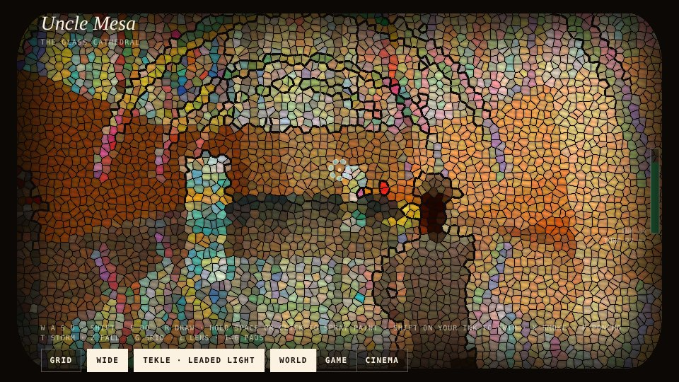
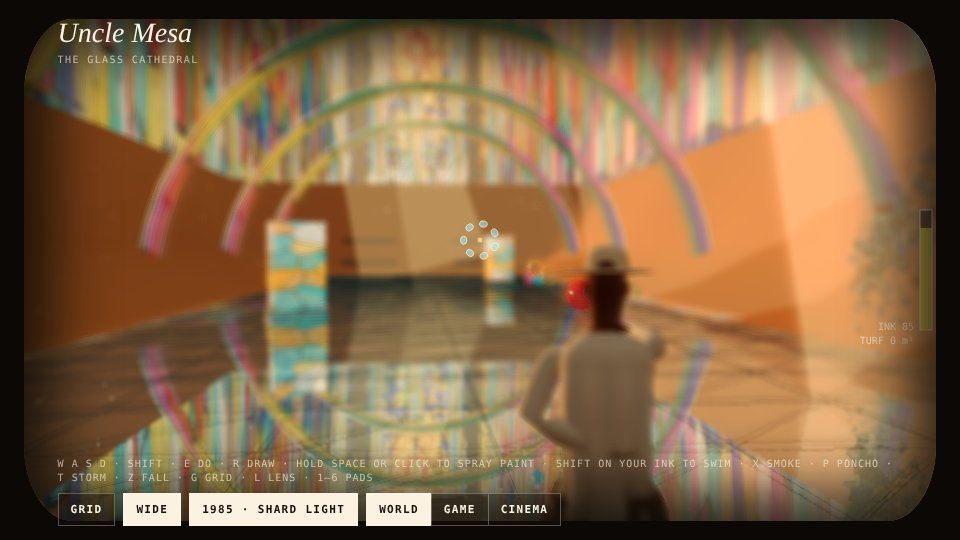
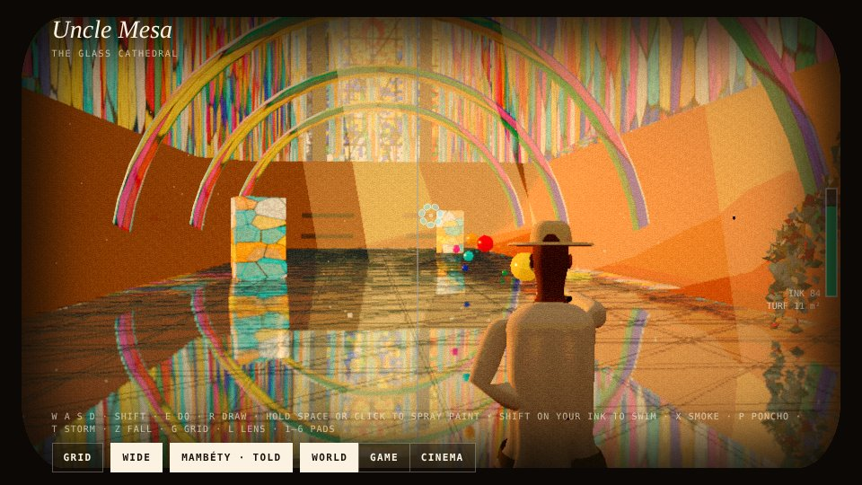
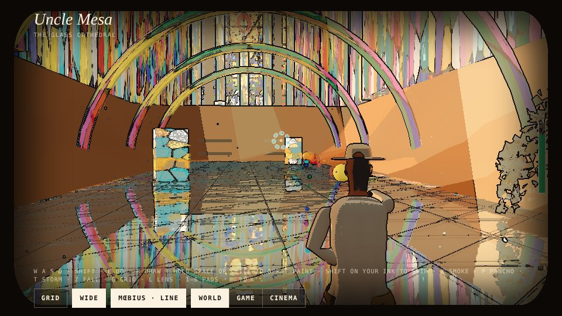
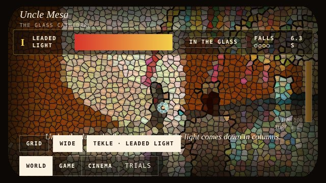
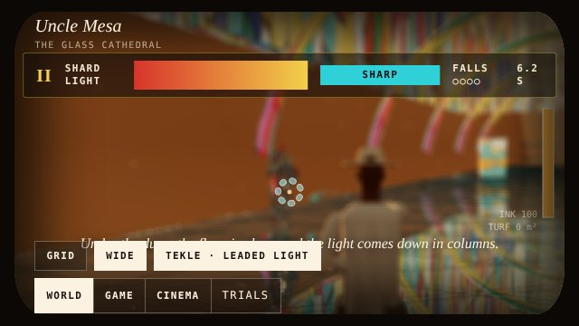
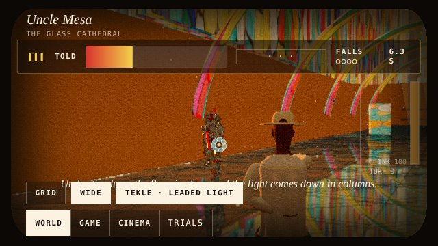
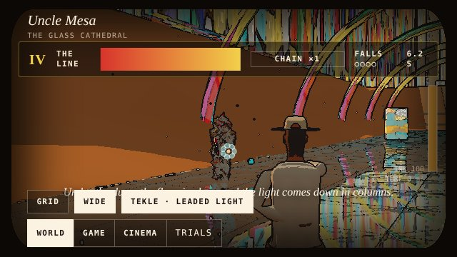

# MESA CHIP

A cyber-western of glass, built from the film's keyframe breakdown (`keyframes.json`). Open `mesa/index.html`.

**Uncle Mesa** is a Black man in his sixties with a long white beard and round white-rimmed glasses with gold lenses. He wears a cream wide-brimmed hat, a white guayabera-style shirt with a yellow-and-blue MESA CHIP pocket badge, khaki trousers and boots, and can put on a dark-weave poncho. He walks north from the title gate through the clockwork iris, past the sign, through the duel arena and down the glass canyon over the sunken cathedral, to the ziggurat under the curtain wall.

**The source film.** The 3-minute cut the breakdown describes is not in the repositories. The El Desierto clip #1147, "MESA CHIP: The Cyber-Western M", is 10 seconds of a cyan grid over the mesas, a chip in the fingers and a rider's eye. So this level follows the written breakdown, not measured frames.

## Playing it

- **On a phone:** the left thumb is a stick wherever it lands; the right thumb turns the view; hold **Fire** to shoot, and slide the same thumb to turn while shooting. The pink button above Fire does what is here (mount, sit, get down). Push the stick to its edge to run, and to swim on your own ink.
- **On a keyboard:** W A S D move where the camera faces, the arrows (or the mouse at the edge of the frame) turn it, Shift runs, Space or a click shoots, E does what is here.
- **Shooting:** pulling the trigger draws; the gun goes away after a few seconds of quiet (R keeps it out). A shot goes to the reticle. If an outlaw, the knight or a prism is within about ten degrees of it, a pink ring closes on him and the shot leads the drop to hit. Each shot throws a pink plume and a ribbon of light, as in the film at 02:13.
- **The shootout** is on from the start (the other choices are Wander and Cinema) and comes to him wherever he is, once he is through the title gate:
  - **Outlaws** ride in three at a time and keep moving between shots. Each takes two hits: the first staggers him, the second puts him down. Each wave is faster than the last. The red ring is still the draw.
  - **Glass chips** hang and drift near him. Breaking one pays ink.
  - **Combo.** Every hit inside about three seconds of the last rings one note higher up a scale, scores more (up to ×10) and speeds the gun. A miss does not break it; time does, and so does being hit.
  - **Three hits.** He has three; they come back one at a time when he is left alone. At none he goes down, loses 300 and gets up.
  - **Dash** (Q, or the blue button): a short burst that paint cannot touch.
  - **Aim help.** While firing, the view leans toward whatever the gun has found. The cone is wider on a touch screen.
  - Clearing a wave slows time for a moment.
- **The trail:** one goal shows at a time; tap it for the whole list.
- **Uncle Mesa** is drawn as the film's frames draw him: lean, a flat brim far wider than his shoulders, round glasses, a beard to the chest, a white shirt.
- **The big glass** (the canyon walls, the curtain wall, the columns) is square panes of pale blue, grey and amber with the colour dragged across in strokes, as the film's glass walls are. The small glass (windows, prisms, the sign, the hall) keeps its leaded cells.

## Keyframe → zone → mechanic

| Keyframe | Time | Zone (`mesa-world.js`) | Effect | Mechanic |
|---|---|---|---|---|
| kf_01 grid intro | 00:04 | `title_gate`: two frosted glass-block towers and a lintel | the glass-block grid over the lens, the barrel-scope mask, dust | the spawn: MESA CHIP resolves through blur; the grid fades after 6 s; **G** toggles it, **Wide** the mask |
| kf_02 iris portal | 00:16 | `clockwork_iris`: a brass ring with twelve glass blades across Main Street | the aperture opens and closes | **sightline**: stand in the iris with the gun up and the blades open wide, the lens closes to 22°, and the mesas sit in the aperture. This is Cinema camera #1 |
| kf_03 glasses and sand | 00:39 | `dune_open` | floating spectacles, gold sand ribbons | **T** sandstorm: the fog closes, gold ribbons wheel round him, white rings drift past |
| kf_04 mural sign | 01:01 | `main_street_glass`, and the sign monolith | stained-glass windows lit from inside; UNCLE MESA / MESA CHIP in leaded glass with the lawman | **prism cover**: glass prisms in the canyon stop the outlaws' shots, and two hits shatter one into physics shards with a cyan or amber flash |
| kf_05 glass canyon | 01:28 | `cathedral_trench`: two walls of stained-glass slabs; the floor sinks 7 m into a mirror-glass cathedral with ribs and god-rays | god-rays; a planar reflection on the floor | walk the trench and down the steps into the cathedral. This is Cinema camera #3, the crane descent |
| kf_06 horse standoff | 01:31 | `silhouette_wall`: an 80 m wall of horizontal stained-glass stripes, the lone horse in front | backlit stripes, coloured light on the sand | **E** saddle up; ride with W A S D, gallop with Shift; the rider plays the `horse-walk` and `horse-trot` clips |
| kf_07 poncho ridge | 01:56 | `hoodoo_ridge`: a raised ridge of hoodoos to the west | dust | **P** the dark-weave poncho |
| kf_08 outlaw glare | 02:01 | `duel_arena`: a ring of adobe walls before the sign | | **Game mode**: three waves of three outlaws. Each draws on a timer, and a red ring fills over his head before he fires. Shoot first, or be behind a prism, or he puts you down |
| kf_09 Mesa Chip fire | 02:13 | `uncle_chip_booth`: a counter, a blue awning, UNCLE CHIP in glass; E to sit | magenta muzzle plume, curved light tracers | **R** draw, **Space** or click fire: crimson and magenta plumes, two curved neon ribbons from the barrel to the hit |
| kf_10 curtain monolith | 02:24 | `north_curtain_wall`: twenty-two glass monoliths 110–200 m tall | vertical colour | ride north to it. This is Cinema camera #5, the wide pullback |
| kf_11 oasis mirror | 02:40 | `oasis_pond`: a still pond in a bowl, sixteen saguaros, stained-glass light on the sand | a planar reflection; the painted sky | **Z** fall and get up |
| kf_12 ziggurat end | 03:03 | `ziggurat_steps`: six stone tiers, glass columns behind | the low sun | **E** sit and rest (`sitting-idle`). This is Cinema camera #6, the closing shot |
| salt flats | 01:10 | a white ring beyond 300 m, fourteen orange buttes | the painted sky in horizontal yellow-and-blue strata | |
| sunburst | 02:53 | the sun | an emerald-gold sunburst in the sky shader; coloured glass light on the ground | **1–6**: six synth pads (detuned saws with tremolo and a sine whistle), each with its time of day: dawn, morning, noon, afternoon, golden hour, dusk |

**The outlaws** are three gaunt, dark-bearded men in dark dusters and hats:
- Jeb, a white man;
- Ramón, a Latino man;
- Silas, a Black man.

**Cinema** cuts between the breakdown's six cameras every 7 s, letterboxed:
1. the iris;
2. the sign;
3. the crane into the cathedral;
4. the silhouette wall in profile;
5. the curtain wall pullback;
6. the ziggurat.

## Paint: the graffiti game (`ink.js`)

Uncle Mesa's six-shooter fires paintballs. Hold Space or the mouse button to spray, as a Splatoon shooter does.

- **The ball.** A real projectile on an arc, stretched along its speed, dropping beads as it goes.
- **Where it lands.** The liquid follows the rain kit's membrane (`night-post/rain/demos/water.js`): blob fields added together and cut at a threshold, so touching drops merge into one body with one hard, bright edge. Each splat is that field, evaluated in a shader on a decal laid against the surface it hit:
  - a main blob;
  - satellite droplets thrown forward;
  - a streak along the line of travel;
  - small extra splats sprayed past it.
- **On a wall the ink runs.** Drips crawl down the face over about 1.8 s and stop in a bead.
- **Then it cures.** For about 1.2 s the ink is wet: bold, glossy, with a darker rim where the bead rolls over. Then it crystallizes from the rim inward: lead lines grow through it, each cell takes its own glass colour leaning toward the paint, and the glass glows with a little sparkle while it sets. The cells are laid out on the surface's own plane, so neighbouring splats share one window.
- **Swimming.** Hold Shift on ink: Uncle Mesa crouches and moves through it at 6 m/s, refilling the tank.
- **The ink tank.** Each shot costs 1.5 of 100. It refills slowly on its own and fast while swimming. The vial by the reticle shows how full it is, in the colour of the next shot.
- **Turf.** Each square metre of upward ground that you ink counts once. The goal is 250 m².
- **Tag spots.** Four frames on the Main Street fronts. Ten hits inside one and it blooms into a lettered stained-glass mural: MESA CHIP, DATA REMEMBERS, UNCLE MESA, THIS LAND.
- **Painted bodies.** Uncle Mesa and the outlaws take paint where they are hit.
  - **Pinned to bones.** A hit is pinned to the nearest of sixteen bones, so it walks, falls and rides with the body.
  - **On the body.** A patch on the body's own materials, run after the cast's own shader hooks: the cloth or skin takes the paint with a ragged edge and runs downward while wet. For about 1.2 s it is glossy, then it crystallizes into small leaded cells and glows, as the world's paint does.
  - **Limit.** Up to 24 marks a body; the oldest goes first.
  - **The outlaws' paint.** They fire paintballs too, three at a time with a little lift for the drop, in Touki Bouki's colours: the red, yellow and green of Senegal's flag and the blue of the Dakar sky. One that reaches Uncle Mesa paints him and puts him down.
  - **Swimming.** Swimming in his own ink leaves it on his boots and shins.
- **Other targets.** Outlaws go down painted, and their colour pools under them. Prisms still crack and shatter.
- **The buffer.** Every splat and drip is one instance in a single instanced mesh, 1,600 at a time; the oldest is reused.

## The horned motorcycle (`touki.js`)

After Touki Bouki (Djibril Diop Mambéty, 1973). A 1970s road bike is parked by the title gate:
- spoked wheels and chrome fenders, a black tank, a long seat and a sissy bar;
- a finned twin engine and an exhaust;
- high chrome bars, with round mirrors on tall stalks;
- a round headlight over the plate "10";
- a zebu skull strapped over the bars, its horns sweeping out wide and nearly flat and curling up at the tips, as on the poster.

**Anta** waits beside it: a Black woman with short natural hair, an olive-green shirt, mustard trousers and a tan leather satchel. When Uncle Mesa rides, she rides pillion. She is from the one cast and takes paint like everyone else.

**Riding** (E, then W A S D, Shift to open it up):
- **Speed:** up to 19 m/s, or about 27 m/s with Shift, which also lifts the front into a wheelie.
- **The bike's body:** it leans into turns, pitches with the ground under each wheel, and the fork turns with the steer.
- **Engine:** the library's small two-stroke idle, pitched up with speed, with smoke from the exhaust.
- **Collisions:** a Rapier character controller keeps it out of walls. Hit one above 13 m/s and the horns hit first and everyone goes over.
- **Paint:** Uncle Mesa can still be painted while riding, because his body rides with the bike.

**Not yet:** there is no motorbike clip in the motion library, so the riders use `sitting-idle`, with their legs forward along the tank.

## The sky and the salt flats

Three references, used together:
- **The sky** follows Superstudio's airbrushed collages:
  - a soft gradient from a pale horizon to blue;
  - long horizontal strokes of cloud laid on as if with an airbrush, lit on top and blue in their shadows;
  - pale mountains drawn along the horizon.

  The six moods (1–6) still tint it, and the emerald-gold sunburst stays.
- **The salt flats** become the Supersurface (Superstudio, 1972): beyond 300 m from the town the ground turns into a glossy pale cyan plane.
  - **The grid:** fine lines every 4 m and major lines every 20 m, both fading with distance.
  - **The finish:** airbrushed blotches of blue-green and pale yellow, and a sheen that catches the horizon at grazing angles.
- **The Continuous Monument** (Superstudio, 1969): a colossal 64 m wall of green glass grid stands on the salt to the east, sixteen panels on an arc at 485 m.
- **The edge of the world** is al-Idrisi's sea from the Tabula Rogeriana (1154): deep blue, with white zigzag waves following the curve of the rim.
- **The buttes** are al-Idrisi's mountains: ten islands of rock at the rim, in bands of red, yellow, orange and purple, edged in dark ink and scalloped with scales.

## Swarms (`swarm.js`) and the Hall of Liberation (`tekle.js`)

One swarm for each reference. Each is our own hand-made version, not a copy.

**How a glass figure is made.** A hidden scion character (a "driver") runs real motion-capture clips on the shared motion driver.
- **Shards on bones.** Hundreds of instanced glass shards are pinned to its bones. Each shard has a bone, an offset in that bone's frame, a spin and a colour.
- **Cheap crowds.** Any number of figures can wear the same pose, each with its own place and heading. A procession costs one skeleton and one draw call.
- **What shards can do.** Fly in from a window to form a figure; be knocked loose by a paint hit, fall, bounce, lie for a few seconds and fly home; take the paint's colour; all blow out at once.

**What each reference became:**

| Reference | Our own version | Its swarm |
|---|---|---|
| Afewerk Tekle, *Total Liberation of Africa* (Africa Hall, 1961) | **The Hall of Liberation** behind the ziggurat: three 22 × 44 m panels painted in code. *Then* is cool and fractured: a dark sun, chains, bowed figures. *Then and now* is the torchbearer raising the flame against a burst of broken light. *Now and the future* is gold, red and green: a rising sun, raised arms, towers, gears, a rocket. Jewel-tone mosaic, figures with large dark eyes in white shamma with tibeb borders, and heavy lead drawn as long calligraphic sweeps over structural bars. The glass throws its colours on the ground | **The procession**: seven marchers of white, brown, green and red glass step one by one out of the centre panel and walk round the ziggurat, right arms raised; the first carries a lit torch |
| The Stained Glass Knight (*Young Sherlock Holmes*, 1985) | **The knight in the sunken glass cathedral**, with a red glass sword and plume. When Uncle Mesa comes down onto the mirror floor, the knight leaps out of a canyon window and hunts him: walking, jogging, then a wind-up and a cut that knocks him flat | 760 shards of silver, gold and red. Paint knocks shards loose and recolours them; after 16 hits he shatters across the floor. He waits in the glass again 30 s after you leave |
| Touki Bouki (1973) | **The Dogon kanaga** on the bike's rear, as on Mory's | **A herd of 14 zebu** (hump, dewlap, lyre horns, a walking gait) flocking over the salt flats: separation, alignment, cohesion and a wandering goal. They are shy of the rider and run when he comes close |
| *Scavengers Reign*, *Akira* | **The Akira trail**: the bike's red tail light leaves a band of light behind it at speed | **160 glass seed-moths** at the oasis in cyan, magenta, lime, violet and gold. They drift, gather round a passer-by, and scatter from every splat |

## Built on

| Part | Used for |
|---|---|
| `CAST_2086` | Uncle Mesa and the outlaws (`ownColors` keeps their colours) |
| Mesh2Motion clips through `m2m-world-bridge.js` | walk, jog, sprint, `horse-*`, `sitting-idle`, `angry` |
| Rapier | the heightfield, every wall and slab, the prisms and their shards, a character controller, outlaw capsules for the hits |
| `makeDonkey` | the horse. As in the Mars level, the cast has no horse yet |
| the trough's glass look | the reticle: seven drops closing as the hand steadies |

The glass is painted at load on canvases: leaded cells around a jittered grid, lead lines where the nearest two cells meet, used as both colour and glow.

## Not yet

- **The source film.** Measuring it would let the look be tuned the way Mars was (`mars/v2g`). The 3-minute cut is needed.
- **The horse:** it is still the donkey.
- **Sound:** gunfire and glass are synthesized.
- **The overworld:** not poured into the trough yet.

## Handmade (PAE-09)

The knight scene, held still as a description and a score taken from this level's own knight machine, is built four times from the bottom up by four SCION swarms: Afewerk Tekle (one fixed leaded window, only the light moves), Lucasfilm 1985 (hand-keyed convex shards), Djibril Diop Mambéty (a griot collage cut from this game's own frames) and Mœbius and Otomo (a clean line, light trails, a bloom before each break). Each film is measured from its own pixels and judged by independent critics: [PAE-09 · MESA CHIP, handmade](https://hartswf0.github.io/bolas/paeleo/mesa-chip/).

## The SCION lenses (L)

The four PAE-09 swarms are also ways of seeing the playable world. Press **L**, or the lens button, to cycle through them. You can also open the level with `?lens=tekle`, `lucas85`, `mambety` or `moebius`.

The game itself does not change: walking, spraying, swimming in ink, the horned motorcycle, the duel, the knight, the stained-glass murals and the mirrors all work as before. The scene renders to a colour and depth target, and one full-screen pass (`lens.js`) turns that picture into the swarm's language.

| Lens | What you see while you play |
|---|---|
| **Tekle · leaded light** | One window, cut once. The cutting is fixed to the glass of the screen and never moves, and the world is the light passing through it. Each piece takes the light at its centre. The lead thickens wherever depth breaks, so the light itself draws Uncle Mesa's and the knight's contours. |
| **1985 · shard light** | A rack focus that follows the fight: it pulls to the knight when the knight is out of the glass and near, and back to Uncle Mesa otherwise. Each facet's highlight blooms on its own, and the shutter stays open across frames, like accumulated sub-frames. |
| **Mambéty · told** | The picture holds and jumps on a plucked rhythm (2, 1, 1, 3, 1, 2, 1, 1, 2, 3 film frames) and cuts on every event, such as a hit, a fall or the shatter. The stock is hot and worn. When he goes down, or the knight goes to pieces, the zebu horns of the motorcycle interrupt, painted with every colour fired so far. |
| **Mœbius · line** | One black line of constant weight wherever depth or colour breaks, with flat colour. Bright, saturated things leave Akira trails: paintballs in flight, the red sword, lit glass. |

   

`lenses.mp4` is a real play session in the glass cathedral with the knight hunting: Uncle Mesa sprays and walks, and the lens changes every few seconds (Plain, Tekle, 1985, Mambéty, Mœbius). It was recorded in software WebGL, so the frame rate is low.

## The Four Trials (the game)

Press **Enter**, or the **Trials** button, to play. You can also open the level with `?trials`. Uncle Mesa meets the glass knight in the sunken cathedral four times, once in each SCION world, and each world's way of seeing is the rule of the fight. A card before each trial gives its rule.

| Trial | World | Rule |
|---|---|---|
| I · Leaded light | Tekle | Only light moves. A column of light moves on across the fight. The knight breaks only while it stands in the light; anywhere else, paint just colours the glass. |
| II · Shard light | 1985 | The rack focus. Hold your aim until it is sharp. Moving, turning or spraying throws the focus, so you plant and fire in bursts. |
| III · Told | Mambéty | A plucked string keeps time. A shot on the beat breaks twice as much glass; a shot off it barely scratches. |
| IV · The line | Mœbius | Every hit blooms. Hit again inside the bloom to chain it: ×2, ×3, ×4. |

You have four falls per trial. After each cut of the sword, the knight steps back and takes a breath while he gets up. The score comes from the clock and the falls. The final card totals all four trials, and the best total is kept in your browser. Esc leaves the trials.

The knight's collider now matches its glass body (radius 0.72 m), so paint that visibly lands on the knight counts. Before this change the collider was a thin capsule inside the shards, and most visible hits passed through.

`trials.mp4` is a real playthrough by a test bot (2.5× speed, software WebGL). It used the test setting `?trialhp=3` (a three-hit knight, so a slow machine can finish), and it won all four trials with no falls. At full strength the knight has 16 HP.

   

## Playable first: stained glass the island-ecology way

**The Tekle lens.** It is now drawn the way `hartswf0/island-ecology` (*BEES ON A TRAIN*, `skill-analyzer.html`) draws stained glass: a real Voronoi of sites built with **d3-delaunay**, drawn as vector cells (fill, then lead) on a 2D canvas over the game. That is far cheaper than the old per-pixel cell search.
- **The cutting** is fixed, about 42 pieces across whatever the screen, so the cost is constant.
- **The figures carry their own cells.** Uncle Mesa, the knight and the outlaws each carry a cluster of small sites, so their silhouettes read in glass and the lead follows their bodies.
- **Colour.** Every cell takes its light from a small GPU-scaled sample of the frame, refreshed every other frame, and is saturated as backlit glass.

`vendor/d3-delaunay.min.js` is d3-delaunay 6.0.4 (ISC, with Delaunator), vendored so it works offline.

**The other lenses** render the scene at 0.7 scale and take far fewer texture reads.

**A frame-rate governor.** If the game falls below 40 fps it renders fewer pixels, in steps down to 0.55 pixel ratio, and gives them back when it recovers.

**The glass-block grid (G).** It reads the frame back every frame while it is on, which is the first 6.5 s after loading and whenever you press G. A profile found this was most of the CPU time in a software-rendered session. Turn it off with G if the opening feels slow.
